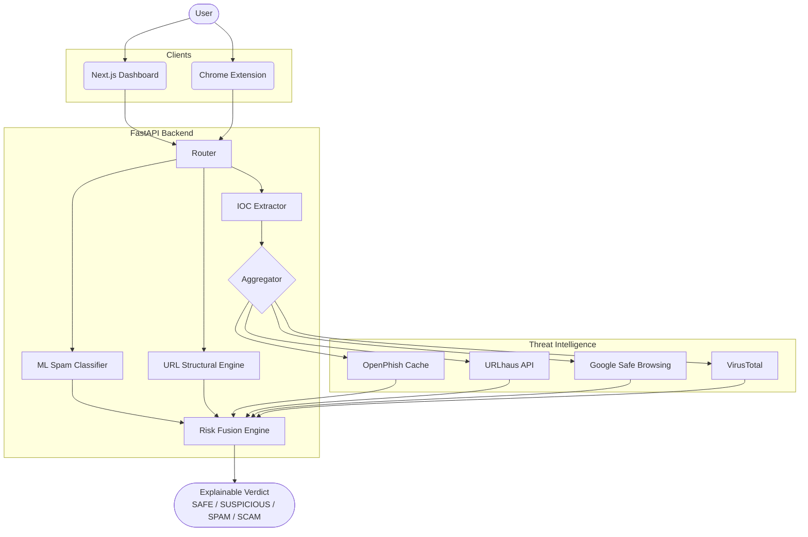

# ScamSentry AI

[](https://github.com/scamsentry/scamsentry-ai)
[](https://opensource.org/licenses/MIT)
[](https://fastapi.tiangolo.com/)
[](https://nextjs.org/)

AI-assisted threat intelligence platform for analyzing suspicious messages, URLs, and webpages. ScamSentry combines natural language processing with live online threat intelligence to produce an explainable risk verdict.

## Features
- **Local Machine Learning**: Scans message semantics for phishing patterns locally without sending private messages to the cloud.
- **Rule-Based Risk Engine**: Evaluates context and urgency in tandem with ML spam probabilities.
- **Automated IOC Extraction**: Automatically discovers Domains, URLs, IPs, and Emails from unstructured text.
- **Live Threat Intelligence**: Connects extracted indicators with OpenPhish, URLhaus, and Google Safe Browsing APIs.
- **Browser Extension**: Seamless one-click page scanning right from your current tab.

## Architecture



## Privacy Model
- **Local Text Analysis:** Message bodies are analyzed entirely on the local FastAPI host using a bundled `scamsentry_model.joblib` artifact.
- **Targeted Intelligence:** Only publicly identifiable Indicators of Compromise (IOCs) such as extracted URLs and Domains are sent to upstream threat intelligence APIs.
- **No Background Tracking:** The browser extension does not track history or automatically scrape sites. It only functions when explicitly invoked by the user on a specific page.

## Screenshots

| Dashboard | URL Analysis | Browser Extension |
|---|---|---|
|  |  |  |

## Installation & Local Development

### 1. Backend Setup
```bash
python -m venv .venv
# source .venv/bin/activate (Linux/Mac)
# .\.venv\Scripts\activate (Windows)
pip install -r requirements.txt
```

### 2. Train the Model (Required)
```bash
python -m ml.download_data
python -m ml.prepare_data
python -m ml.train
```

### 3. Environment Config
```bash
cp .env.example .env
# Fill in your development API keys
```

### 4. Run Locally
```bash
# Terminal 1: Backend
uvicorn backend.main:app --reload --port 8000

# Terminal 2: Frontend
cd frontend
npm install
npm run dev
```
Navigate to `http://localhost:3000`.

## Deployment

ScamSentry AI is designed for seamless deployment via Docker containers on PaaS providers like Render, Railway, or Fly.io.

See [docs/deployment.md](docs/deployment.md) for a comprehensive guide on deploying the backend to Render, the frontend to Vercel, and securely configuring production environment variables.

## API Documentation

When the backend is running, the interactive OpenAPI documentation is available at `/docs`.

Key Endpoints:
- `GET /health` - Basic liveness probe.
- `GET /ready` - Full readiness probe, validating provider status and ML model state.
- `POST /predict` - Message analysis endpoint.
- `POST /scan-url` - URL structural + threat intelligence scan.
- `POST /scan-page` - Deep webpage scan extracting up to 50 links for threat matching.

## Testing
Run the comprehensive `pytest` suite locally:
```bash
pytest
```

### VirusTotal Integration

VirusTotal is integrated as an **optional** threat intelligence provider using the API v3. Due to strict public/non-commercial API restrictions, it requires special care:

- **Rate Limiting:** The public API is limited to 4 requests/minute and approximately 500 requests/day. ScamSentry enforces this locally to prevent bans.
- **Caching:** VirusTotal responses are cached for 24 hours to preserve your quota.
- **Page-Scan Prioritization:** During a full page scan (/scan-page), ScamSentry will not blindly send all links to VirusTotal. Instead, it prioritizes up to 1 (configurable) high-risk link based on structural anomalies or matches from other providers.
- **Privacy Precautions:** VirusTotal queries may become part of their public dataset. ScamSentry automatically filters out and skips internal IPs, localhost domains, and URLs containing sensitive query parameters (like tokens, passwords, or session IDs) before sending them to VirusTotal.
- **Configuration:** To enable it, set `VIRUSTOTAL_ENABLED=true` and provide your `VIRUSTOTAL_API_KEY` in the `.env` file.

## Limitations
- **This tool does not guarantee a URL is safe.** A `NO MATCH` response simply indicates the URL is not currently listed in the integrated threat databases.
- The machine learning model is trained on primarily English SMS/Email datasets.
- Heavy usage may require commercial API keys for URLhaus and Google Safe Browsing.

## Future Roadmap
- Integration with Hugging Face transformers (e.g., DistilBERT) for improved contextual semantic analysis.
- PDF and Email header `.eml` parsing support.
- Deep dynamic URL analysis using a headless browser sandbox.
